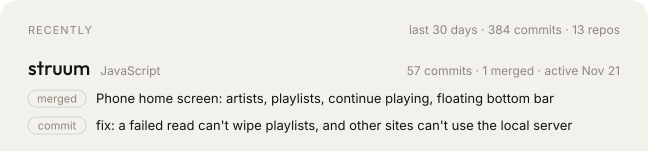
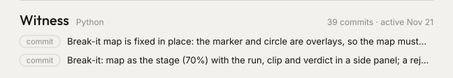
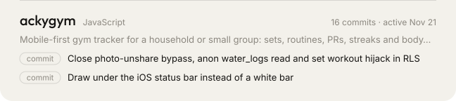

<!-- Generated by scripts/render.py. Edit profile/README.template.md or profile/config.json instead. -->

<a href="https://www.linkedin.com/in/kevinyinkyy"><picture><source media="(prefers-color-scheme: dark)" srcset="./profile/banner-left-dark.svg"></picture></a><picture><source media="(prefers-color-scheme: dark)" srcset="./profile/banner-art-dark.svg"></picture>

<picture><source media="(prefers-color-scheme: dark)" srcset="./profile/streak-dark.svg"></picture>

<picture><source media="(prefers-color-scheme: dark)" srcset="./profile/contributions-dark.svg"></picture>

<a href="https://github.com/kevinyyin/struum"><picture><source media="(prefers-color-scheme: dark)" srcset="./profile/recent-1-dark.svg"></picture></a><a href="https://github.com/kevinyyin/Witness"><picture><source media="(prefers-color-scheme: dark)" srcset="./profile/recent-2-dark.svg"></picture></a><a href="https://github.com/kevinyyin/ackygym"><picture><source media="(prefers-color-scheme: dark)" srcset="./profile/recent-3-dark.svg"></picture></a>

